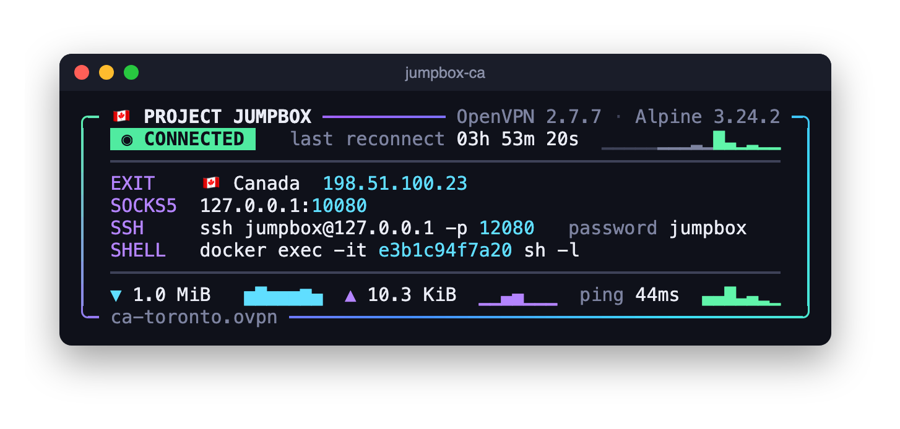
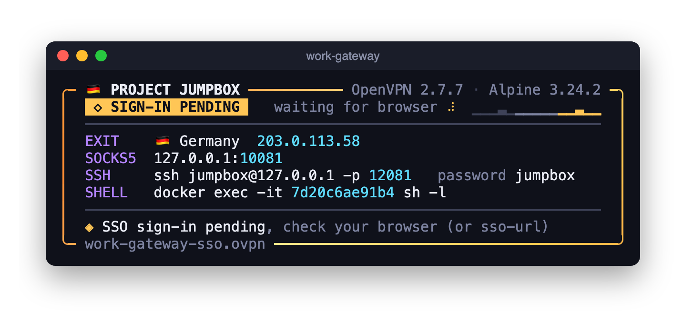
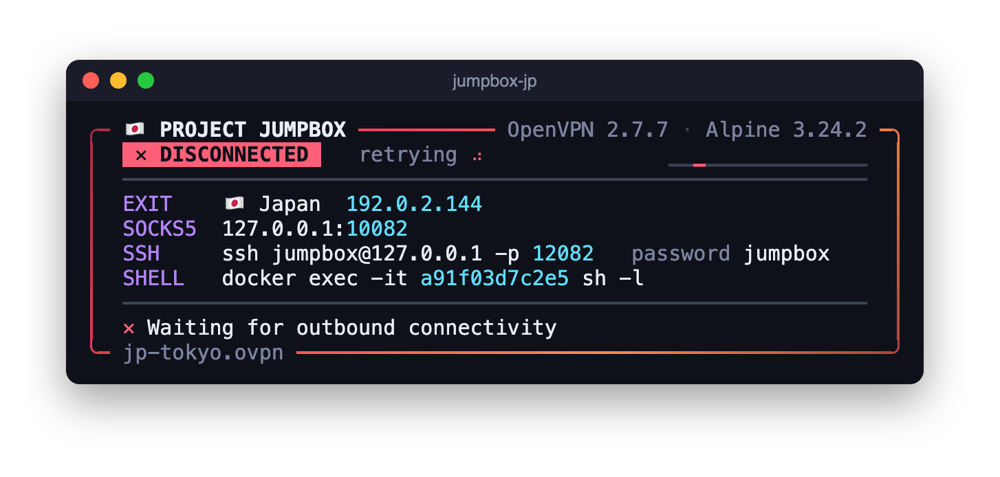
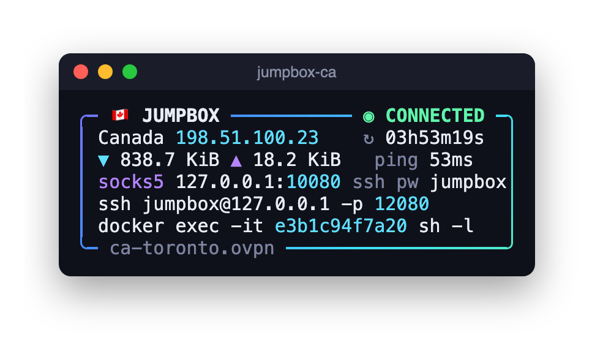
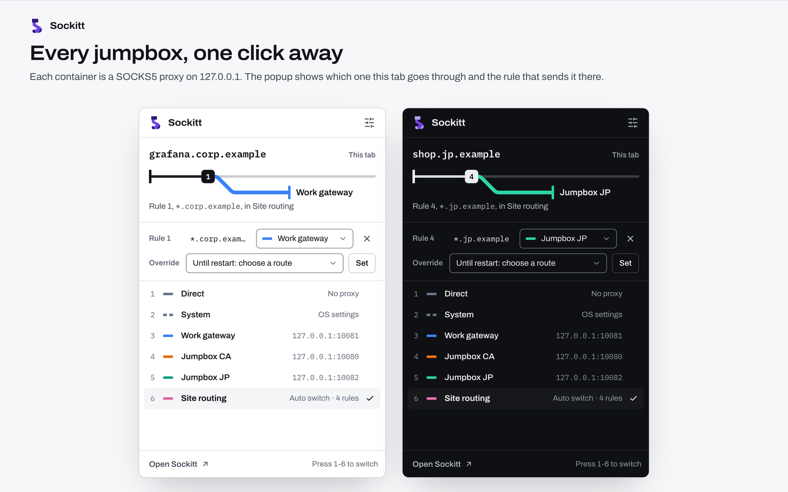
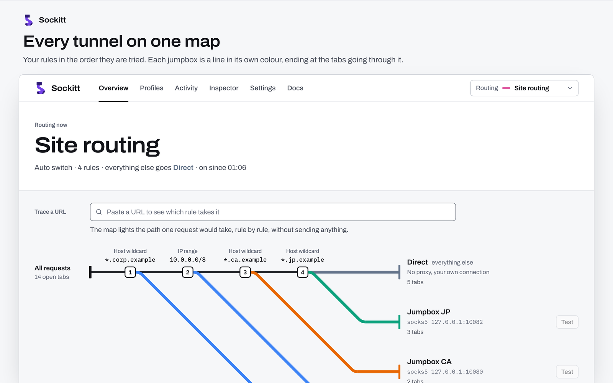

# Project Jumpbox

Run an OpenVPN profile in its own Docker container and use it as a local
**SOCKS5 proxy** and **SSH jump host**. The VPN never touches your machine's
routes or DNS. Only the traffic you send to the container goes through the
tunnel, and a kill switch keeps that traffic from leaking out any other way.

Run one container per VPN, all at the same time: a work gateway, a client's
network, a VPS in another country. Then pick a tunnel per browser profile or
per site with [Sockitt](#using-it-with-sockitt).

<p align="center">
  
</p>

## Features

- **SOCKS5 proxy** (Dante) that only ever exits through the tunnel.
- **SSH server** inside the tunnel's network, for `ssh -J`, port forwards,
  `scp`, and so on.
- **Kill switch.** Inside the container, iptables drops everything except
  loopback, the Docker network, the tunnel, and OpenVPN's own connection to
  its server. IPv6 is dropped entirely. If the tunnel goes down, proxied
  traffic fails instead of going out your normal connection.
- **Live status panel**: connection state, exit IP and country, the
  proxy/SSH/shell commands, transfer totals and rates, gateway latency, and
  the time since the last reconnect. It has a compact layout for small
  panes, and prints plain log lines when run detached.
- **Authentication**: certificate-only profiles, username/password, a
  one-time code (TOTP), an encrypted private key, and OpenVPN Access Server
  SAML / SSO (browser sign-in).
- **Stays connected.** OpenVPN reconnects on its own. Server hostnames are
  pinned so reconnects don't depend on the VPN's DNS, and re-pinned if the
  server moves. `vpn-restart` gives a clean restart from inside.
- **A toolbox inside the tunnel**: `curl`, `dig`, `mtr`, `nmap`, `tcpdump`,
  `iperf3`, `socat`, `ipmitool`, `sshpass`, `rsync` and more.

## Requirements

- Docker. Developed and tested on Docker Desktop for macOS on Apple silicon.
  The image is plain Alpine and should build anywhere Docker runs.
- `--cap-add NET_ADMIN` on every container, so it can create its tun device
  and set up the kill switch.
- **A full-tunnel OpenVPN profile**, one that sends all traffic through the
  VPN (`redirect-gateway`). The jumpbox's proxy only exits through the
  tunnel, so with a split-tunnel profile, every destination the VPN doesn't
  route simply fails. If your profile is split only because the server
  pushes a short route list, but the server will carry all traffic, add
  `-e ROUTEALL=true` to make it a full tunnel.

## Quick start

**1. Put this VPN's files in a folder of their own.** It's mounted read-only
at `/vpn`, and everything in it can be read inside the container, so keep
other profiles out of it:

```
~/vpn/office/
├── office.ovpn         # the OpenVPN profile
└── office-auth         # optional: username on line 1, password on line 2
```

**2. Build the image**, from a clone of this repository:

```sh
docker build -t jumpbox .
```

**3. Start a jumpbox:**

```sh
docker run -it --init --rm --name jumpbox-office \
  --cap-add NET_ADMIN \
  -p 127.0.0.1:10080:1080 \
  -p 127.0.0.1:12080:22 \
  -e DCN=jumpbox-office \
  -e PORT=10080 \
  -e OVPNFILE=office.ovpn \
  -e AUTHFILE=office-auth \
  -v ~/vpn/office:/vpn:ro \
  jumpbox
```

The status panel comes up once the tunnel connects. **Ctrl-C** shuts the
container down cleanly.

**4. Use it:**

```sh
# Through the SOCKS5 proxy (--socks5-hostname resolves names over the VPN)
curl --socks5-hostname 127.0.0.1:10080 https://ifconfig.me

# As an SSH jump host to a machine on the VPN's network (password: jumpbox)
ssh -J jumpbox@127.0.0.1:12080 admin@10.20.0.5

# A root shell inside the tunnel
docker exec -it jumpbox-office sh -l
```

> **Publish ports on `127.0.0.1` only.** The SOCKS5 proxy has no
> authentication, and the SSH login is `jumpbox` / `jumpbox` for every
> container. `-p 10080:1080` without the address would offer both to your
> whole network. See [Security](#security).

## Configuration

Everything is set with `-e` environment variables. The container always
listens on 1080 (SOCKS5) and 22 (SSH). `PORT` and `SSHPORT` don't change
that: they tell the panel which host ports you mapped, so it can show you the
right commands.

| Variable | Required | What it does |
| --- | --- | --- |
| `DCN` | yes | The container's display name, shown in the shell prompt. Normally the same as `--name`. |
| `PORT` | yes | The host port you published for SOCKS5 (`-p 127.0.0.1:<PORT>:1080`). |
| `OVPNFILE` | yes | The profile's file name inside `/vpn`. |
| `SSHPORT` | no | The host port you published for SSH. Defaults to `PORT + 2000`. |
| `AUTHFILE` | no | A file in `/vpn` passed to `--auth-user-pass`: the username on line 1 and the password on line 2. |
| `OTP` | no | `true` for servers that want a one-time code. The code goes on the line after the `AUTHFILE` contents, so an `AUTHFILE` holding just the username sends the code as the password. |
| `OTPIN` | no | The one-time code for `OTP=true`. Without it, the container asks for one at startup. |
| `PRIVKEY` | no | The passphrase for an encrypted private key in the profile (used with `OTP=true`). |
| `OPITEM` | no | A 1Password secret reference for `vpn-restart` to read a fresh code from, if you install the `op` CLI in the container and give it a token (which, like any `-e` value, `docker inspect` shows). Otherwise `vpn-restart` asks for one. |
| `SSO` | no | `true` for OpenVPN Access Server SAML / web sign-in. See [SSO sign-in](#sso-sign-in). |
| `ROUTEALL` | no | `true` adds `--redirect-gateway def1`: routes all traffic through the tunnel when the profile doesn't already. |
| `CONNCHECK` | no | `tunnel` reports "connected" once OpenVPN is up, rather than when `8.8.8.8` / `1.1.1.1` answer a ping through the tunnel. For VPNs that block ping. |
| `CUSTOMCONF` | no | A file in `/vpn` run as a root shell script after OpenVPN and sshd start: add aliases, install packages, set up SSH keys. |
| `GEOAPIKEY` | no | An [ip2location.io](https://www.ip2location.io/) API key for the exit country and flag on the panel. Without a working key, the panel shows just the IP. |
| `TZ` | no | Time zone for log timestamps, e.g. `UTC`. |

### Inside the container

| Command / file | |
| --- | --- |
| `vpn-restart` | Restarts OpenVPN cleanly, waits for the tunnel, and prints the new public IP. |
| `sso-url` | Prints the pending SSO sign-in URL. `sso-url -f` keeps printing each new one. |
| `/var/log/openvpn.log` | OpenVPN's log: the first place to look when a connection won't come up. |
| `/var/log/sockd.log` | The SOCKS5 proxy's log. |
| `/var/log/jumpbox.log` | The connection watcher's events: SSO windows that lapsed, servers that moved. |

### Running several at once

Give each container its own name and port pair. Using the PORT + 2000
convention for SSH keeps them easy to remember:

| Container | SOCKS5 | SSH |
| --- | --- | --- |
| `jumpbox-ca` | `127.0.0.1:10080` | `127.0.0.1:12080` |
| `work-gateway` | `127.0.0.1:10081` | `127.0.0.1:12081` |
| `jumpbox-jp` | `127.0.0.1:10082` | `127.0.0.1:12082` |

A shell function per profile makes each one a single command:

```bash
jumpbox-ca() {
  docker run -it --init --rm --name jumpbox-ca --cap-add NET_ADMIN \
    -p 127.0.0.1:10080:1080 -p 127.0.0.1:12080:22 \
    -e DCN=jumpbox-ca -e PORT=10080 -e OVPNFILE=ca-toronto.ovpn \
    -e GEOAPIKEY="$GEOAPIKEY" -e TZ=UTC \
    -v ~/vpn/ca:/vpn:ro jumpbox
}
```

Run with `-d` instead of `-it` and there's no panel. The state goes to
`docker logs` as plain, timestamped lines instead.

## The status panel

The panel repaints itself in place every second, so a resize or stray output
never leaves lines behind. The badge and border colour follow the state:

<p align="center">
  <br>
  <sub>Waiting for an SSO sign-in in the browser</sub>
</p>
<p align="center">
  <br>
  <sub>Tunnel down and OpenVPN retrying: the kill switch blocks proxied traffic until it's back</sub>
</p>
<p align="center">
  <br>
  <sub>The compact layout, for panes smaller than 66 × 10</sub>
</p>

## SSO sign-in

For an OpenVPN Access Server profile that signs in through a browser (SAML),
add `-e SSO=true`. The sign-in URL is printed while
the container starts, the panel shows **SIGN-IN PENDING** until you finish,
and `sso-url` prints the URL at any time.

To have the sign-in page open by itself, follow `sso-url -f` from the host.
On macOS:

```bash
# Opens each new SSO sign-in page from a jumpbox container in the browser
jumpbox_sso_open() {
  local name=$1 url i
  for i in {1..60}; do
    docker exec "$name" true &>/dev/null </dev/null && break
    sleep 1
  done
  docker exec "$name" sso-url -f 2>/dev/null </dev/null | while read -r url; do
    [[ $url == https://* ]] && open "$url"
  done
}

work-gateway() {
  jumpbox_sso_open work-gateway & disown
  docker run -it --init --rm --name work-gateway --cap-add NET_ADMIN \
    -p 127.0.0.1:10081:1080 -p 127.0.0.1:12081:22 \
    -e DCN=work-gateway -e PORT=10081 -e OVPNFILE=work-gateway-sso.ovpn \
    -e SSO=true -v ~/vpn/work-gateway:/vpn:ro jumpbox
}
```

On Linux, use `xdg-open` in place of `open`.

If the server issues a session token, reconnects reuse it and don't need the
browser again. If a sign-in window runs out without being approved, OpenVPN
stops rather than opening a fresh sign-in page every few minutes. The panel
says so, and `vpn-restart` starts over.

## Using it with Sockitt

[Sockitt](https://chromewebstore.google.com/detail/sockitt-%E2%80%94-proxy-switcher/ebfioiljhjgijbmnnpgadkgmokjbjkca)
is a proxy switcher for Chromium browsers. Each jumpbox is a SOCKS5 proxy,
so each one becomes a Sockitt profile, and Sockitt decides which tunnel each
site goes through.

<p align="center">
  <br>
  <sub>The popup: which jumpbox this tab goes through, the rule that sends it there, and every jumpbox a click or a number key away</sub>
</p>

1. **Add a proxy per jumpbox.** Open Sockitt's options (right-click the
   toolbar icon, **Options**), go to **Profiles**, and choose
   **New › Proxy server**. Set the protocol to **SOCKS5**, the host to
   `127.0.0.1`, and the port to that jumpbox's `PORT`.
2. **Send the whole browser through one.** Pick the profile in the Sockitt
   popup.
3. **Or route by site.** Choose **New › Auto switch** and add rules such as
   `*.corp.example` → *Work gateway*, `10.0.0.0/8` → *Work gateway*, and
   regional sites → the jumpbox in that country. Leave everything else going
   *Direct*. Activate it, and every request goes through the right tunnel on
   its own.

<p align="center">
  <br>
  <sub>The Overview draws your rules as a track map: each jumpbox is a line in its own colour, ending at the tabs going through it</sub>
</p>

Why the two fit together:

- **Names resolve over the VPN.** Chromium hands the hostname to a SOCKS5
  proxy instead of looking it up itself. The jumpbox resolves it with the
  DNS the VPN pushed, so internal names work in the browser with no changes
  to your machine's DNS.
- **Both sides fail closed.** If a jumpbox is down, Sockitt fails the
  requests routed to it and marks its toolbar icon, rather than quietly
  sending them direct. The jumpbox's kill switch does the same inside the
  container.
- **The same exit IP, both ways.** Sockitt's optional exit-IP line in the
  popup shows where the current tab comes out. It should match the EXIT row
  on that jumpbox's panel.
- **No SOCKS authentication is needed.** Chromium can't authenticate to
  SOCKS proxies, which is why the jumpbox's proxy has none and is published
  on `127.0.0.1` only.

## Security

- **Bind to loopback.** Always publish with `-p 127.0.0.1:…`. The SOCKS5
  proxy is open to anyone who can reach it, and the SSH password is
  published here.
- **Other containers can reach it as well.** Containers on the same Docker
  network can use the proxy and SSH directly at the container's own address,
  whatever you published. On Linux, so can any process on the host. If you
  run containers you don't trust, give each jumpbox a network of its own:
  `docker network create jumpbox-ca`, then add `--network jumpbox-ca`.
- **The SSH user can read everything in `/vpn`.** That covers every profile,
  password and key in the folder you mount. On Docker Desktop, file
  permissions don't stop it. Give each jumpbox a folder holding only its
  own files, as in the examples above, never one folder for all of them.
- **Replace the default SSH login.** Anyone who reaches the SSH port can log
  in with the published password. A `CUSTOMCONF` script can install your
  own key and set a random password:

  ```sh
  # ~/vpn/office/jumpbox-custom, run with -e CUSTOMCONF=jumpbox-custom
  install -d -m 700 -o jumpbox -g jumpbox /home/jumpbox/.ssh
  install -m 600 -o jumpbox -g jumpbox /vpn/authorized_keys /home/jumpbox/.ssh/authorized_keys
  echo "jumpbox:$(head -c 24 /dev/urandom | base64)" | chpasswd
  ```

  Put your public key in `~/vpn/office/authorized_keys`. The panel still
  shows the default password, but after this it no longer works.
- **Environment variables are visible.** Anyone who can run
  `docker inspect` can read `OTPIN`, `PRIVKEY` and `GEOAPIKEY`. They are
  also briefly in the container's process list, where the SSH user can see
  them: `OTPIN` and `PRIVKEY` while OpenVPN starts, `GEOAPIKEY` while the
  country lookup runs. Keep long-lived secrets in files (`AUTHFILE`) rather
  than in `-e` flags.
- **The kill switch protects the container, not your machine.** Traffic you
  don't send to a jumpbox uses your normal connection, as it would without
  one. That's the point of the design.
- Root has no password inside the container. Outside the Docker network,
  only the tunnel and processes in the `vpn` group (OpenVPN and its server
  lookups) can send anything.

## How it works

At startup, [`start.sh`](configs/start.sh) runs these steps from
[`inc.sh`](configs/inc.sh) in order:

1. **`killSwitch`**: iptables `DROP` by default, IPv6 `DROP` entirely.
   Allowed: loopback, established connections, the Docker network, `tun0`,
   and any process in the `vpn` group.
2. **`connectOvpn`**: pins the profile's server hostnames in `/etc/hosts`,
   then starts OpenVPN as a daemon under the `vpn` group. On every
   (re)connect, [`up.sh`](configs/up.sh) writes the pushed DNS servers to
   `/etc/resolv.conf` and makes sure the SOCKS5 proxy is running. The proxy
   is [Dante](https://www.inet.no/dante/), listening on `eth0:1080`, egress
   `tun0` only.
3. **`sshdStart`** and **`connCheck`**: sshd, and a watcher that checks the
   tunnel every 5 seconds. It re-pins server addresses after a long outage
   and stops OpenVPN when an SSO window lapses.
4. **`custom`** runs your `CUSTOMCONF` script, **`waitConn`** waits for the
   first connection, and **`display`** draws the panel until you stop the
   container.

## Tests

[`tests/suite.py`](tests/suite.py) drives the real image under a
pseudo-terminal and checks the screen cell by cell through the
[pyte](https://github.com/selectel/pyte) terminal emulator. It has two kinds
of test:

- **mock**: the real panel against a fake OpenVPN and a veth "tunnel", no
  VPN needed. Covers every layout and size, resizes, key presses, stop
  signals, and hostile geo-lookup data.
- **e2e**: the real `start.sh` against a throwaway OpenVPN server in Docker,
  using a test PKI generated on first run. Covers the main flow, SSO (with
  a scripted sign-in), outages, a server moving to a new address, and
  `vpn-restart` locking.

```sh
cd tests
python3 -m venv .venv && .venv/bin/pip install pyte
JBX_DEV=1 .venv/bin/python suite.py mock      # or e2e, or all
```

`JBX_IMAGE` picks the image to test (default `jumpbox:latest`). `JBX_DEV=1`
mounts your working copies of the scripts over the image's, so a change can
be tested before rebuilding.
`JBX_WORKERS` sets how many tests run in
parallel (default 4). The `cpu` test compares against an older build named by
`JBX_OLD_IMAGE`. Tests only create containers and networks named `jbx-t<n>…`.

## Project layout

```
Dockerfile
configs/
  start.sh          entrypoint: the startup sequence above
  inc.sh            everything else: kill switch, OpenVPN, watcher, panel
  up.sh             OpenVPN --up hook: DNS, SOCKS5 proxy
  vpn-restart.sh    /usr/local/bin/vpn-restart
  sso-url.sh        /usr/local/bin/sso-url
  sockd.conf        Dante SOCKS5 config (sockd.sh starts it)
  sshd_config, motd.sh, motd_head, openssl.cnf
tests/
  suite.py          the test suite
  jbxterm.py        pty + pyte harness and screen checks
  e2e.py, e2e/      the local OpenVPN server rig
  mock/             the mock environment for panel tests
```
